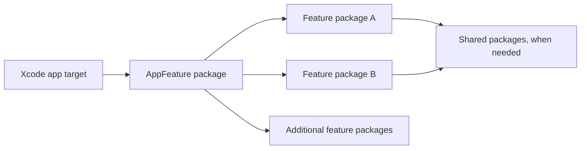
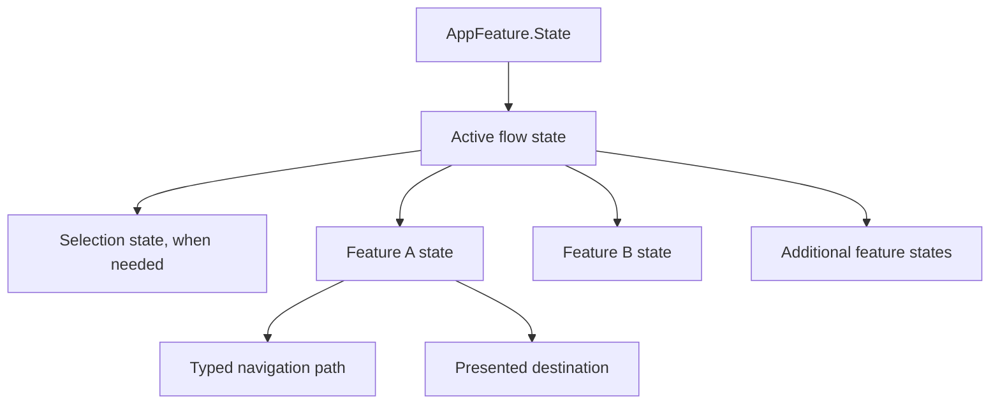

# Architecture

## Package boundaries

The Xcode app target is a lightweight SwiftUI composition root.

- `AppFeature` composes application flows and feature packages.
- Create a local Swift package for each meaningful feature, with its own `Package.swift`, reducer, state, actions, views, previews, and tests. Keep dependencies explicit and public APIs small. 
- `DesignSystem` owns shared visual foundations and common UI elements; feature-specific UI stays in its owning feature package. See [Design system](Design%20System.md).

Register each local feature package in the `packages` section of `project.yml` so XcodeGen places it in the project navigator. This registration is for project visibility; only `AppFeature` is linked directly to the app target. Declare feature-to-feature dependencies in the owning package manifests.

Parents may depend on children; children never depend on parents. Avoid dependencies between sibling features and circular imports. Domain models should remain independent of SwiftUI and TCA where practical. External systems belong behind TCA dependencies with live, preview, and test implementations as appropriate.

## State and effects

The root state composes the active application flow and its child feature states. Each feature owns its own domain and navigation state. Lift state only when multiple features genuinely need one owner; communicate meaningful child events through delegate actions. Scope stores at composition boundaries. Keep business logic and side effects in reducers and dependencies, not SwiftUI views.

Use structured concurrency, explicit effect cancellation, actor isolation, and `Sendable` correctness. Do not add Combine without an integration requirement or suppress concurrency diagnostics to make code compile.

## Project and dependency management

`project.yml` is the source of truth for the Xcode project. Generate `Vistora.xcodeproj` with `xcodegen generate` or `./Scripts/bootstrap.sh`; never edit the generated project. SwiftPM manifests define package dependencies. The tracked root `Package.resolved` pins Xcode dependency resolution; package-local resolution files are ignored. The packages and app use Swift 6 language mode.

## Validation and documentation

Use TCA `TestStore` and Swift Testing for meaningful reducer behavior. Use XCTest/XCUITest for visible flows where appropriate. Tests should cover state transitions, effects, navigation, errors, cancellation, and child-to-parent communication as those behaviors are added. Provide representative previews and directly constructible state scenarios. Run builds and tests only when the user explicitly requests them; report what was and was not validated.

See [Navigation](Navigation.md) for state-driven navigation.
