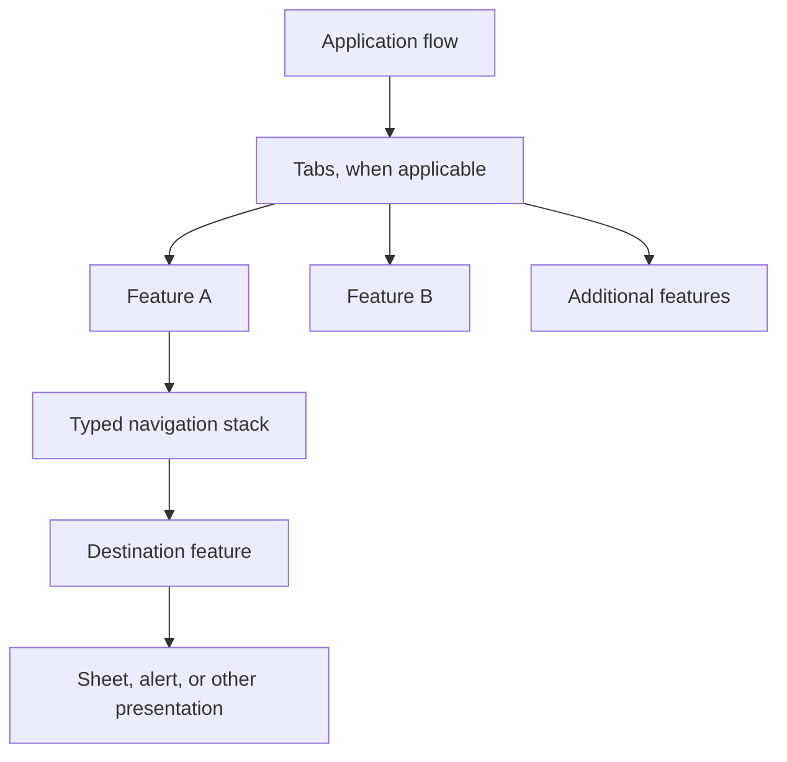

# Navigation

Use the TCA state hierarchy as the single source of navigation truth. Choose the navigation form that matches the relationship between screens:

- **Tree composition:** Represent application flows, authentication, onboarding, tabs, and stable parent-child relationships with composed reducer and state types. A tab container owns selection; each tab owns its feature state and, when useful, its independent navigation stack.
- **Stack navigation:** Use typed `StackState<Path.State>` and `StackActionOf<Path>` for drill-down journeys and repeated or dynamic destinations. Compose path reducers in the owning feature.
- **Presentation navigation:** Use `@Presents` and `PresentationAction` for sheets, full-screen covers, alerts, confirmation dialogs, and popovers.

Navigation changes are actions handled by reducers. Do not maintain a separate mutable router or issue imperative navigation commands from views. Every active destination must be addressable through root state, including stack elements and presented features.

Construct initial states for specific selections, stacks, details, presentations, loading, errors, and empty states when those cases exist. Reuse these fixtures in previews, tests, deep links, and Debug-only launch scenarios. Document scenario identifiers near their implementation and keep the launcher out of Release builds. If restoration becomes necessary, model the persisted navigation data explicitly rather than serializing all TCA state.
